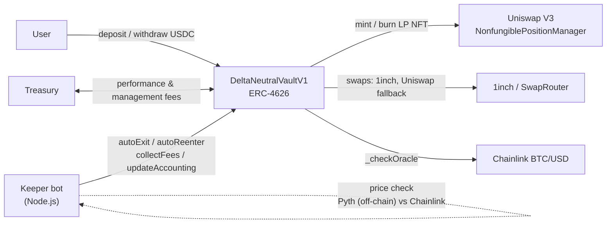

# Neutalp — Delta-Neutral Vault for Uniswap V3

[](https://github.com/leandrosmoreira53/Neutalp/actions/workflows/test.yml)
  

An **ERC-4626 vault** that provides concentrated liquidity on **Uniswap V3** (e.g. WBTC/USDC) and manages it as a
**delta-neutral** strategy: users deposit USDC and receive vault shares; an off-chain **keeper** opens, exits and
re-enters the LP range, and every price the keeper submits is **checked on-chain against a Chainlink oracle**
before anything moves.

> Status: **testnet prototype** (Arbitrum Sepolia). Not audited — do not use with real funds.
> See [Known limitations](#known-limitations).

## Architecture



## What the contract does

- **ERC-4626 shares** over USDC (OpenZeppelin 5), with `Pausable`, `ReentrancyGuard` and `Ownable`.
- **Keeper-only strategy actions** — `autoExit` (with an `ExitReason`: manual, range, emergency, rebalance),
  `autoReenter`, `collectFees`, `updateAccounting`, and `recordHedgeState` for an auditable record of the hedge.
- **Oracle guard** — the keeper's price must agree with Chainlink within `maxOracleDeviationBps` (default 5%)
  and Chainlink data must be fresher than `maxOracleDelay` (default 1 h).
- **Swaps** through the 1inch aggregator, with Uniswap V3 `SwapRouter` as fallback and `maxSlippageBps` protection.
- **Fees with hard caps** enforced in `setFees`: performance ≤ 15%, management ≤ 10%, swap ≤ 10%, keeper ≤ 5%;
  **entry and exit fees fixed at 0%**.
- **Emergency path** — owner can pause and call `emergencyExitToUSDC` to close the LP position into USDC.
- Uniswap V3 math (`TickMath`, `FullMath`, `LiquidityMath`) ported to Solidity 0.8.

The **keeper bot** ([`keeper-bot/`](keeper-bot), Node.js) cross-checks **Pyth** (off-chain, Hermes API)
against **Chainlink** within a configurable maximum deviation, runs a health check of oracles and vault on
start, and runs in `DRY_RUN` mode by default.

## Deployed (Arbitrum Sepolia, chain id 421614)

| Contract | Address |
|---|---|
| `DeltaNeutralVaultV1` | [`0x844bc19aeb38436131c2b4893f5e0772162f67d6`](https://sepolia.arbiscan.io/address/0x844bc19aeb38436131c2b4893f5e0772162f67d6) |
| WBTC mock (`MockERC20`) | [`0xef39185d82f3dd98046107d6ca9ba2af77a2b5df`](https://sepolia.arbiscan.io/address/0xef39185d82f3dd98046107d6ca9ba2af77a2b5df) |

Deployment, pool creation, configuration, range and deposit transactions are recorded in
[`broadcast/`](broadcast). **The deployed vault predates the deposit fix below** — redeploy before testing deposits.

## Tests

```bash
git clone --recurse-submodules https://github.com/leandrosmoreira53/Neutalp && cd Neutalp
forge build
forge test -vv
```

**32 tests** (unit, fuzz with 256 runs and invariants) cover deployment and access control, fee caps,
deposit / withdraw, management-fee accrual, pausing, stale and deviating oracle prices, and gas benchmarks.
CI runs `forge build` and `forge test` on every push.

Dependencies are git submodules pinned to exact versions: OpenZeppelin Contracts **v5.5.0**, Chainlink
contracts **1.3.0**, Uniswap **v3-core v1.0.0** and **v3-periphery v1.3.0**, forge-std **v1.9.6**.

## Security fix: first depositor received zero shares

The original `deposit` transferred the USDC **before** computing shares, so `totalAssets()` already included
the new deposit. With OpenZeppelin's virtual-share math, the first deposit of 10,000 USDC minted
`10_000e6 × 1 / (10_000e6 + 1) = 0` shares — the depositor lost everything and later depositors were diluted.

The fix computes shares **before** the transfer and rejects deposits that would mint zero shares.
`test_Deposit_FirstDepositorGetsFairShares` reproduces the bug: it **fails on the old contract (0 shares)** and
passes on the fixed one (10,000e6 shares).

## Known limitations

- **`totalAssets()` does not price the non-USDC leg.** When an LP position is open, the WBTC amount is added as
  if it were USDC (marked "simplification" in the code). Share pricing is only correct while the vault is
  fully in USDC; a production version must convert the position with the oracle price.
- The hedge itself is executed off-chain; the contract only records it (`recordHedgeState`).
- Not audited. Testnet only.

## Project layout

```
src/        DeltaNeutralVaultV1 (+ testnet variant), interfaces, Uniswap math libraries, mocks
test/       Foundry tests (unit, fuzz, invariants)
script/     Deploy, pool creation, configuration and diagnostics (forge script)
keeper-bot/ Off-chain keeper (Node.js, ethers): Chainlink + Pyth cross-check, dry-run first
broadcast/  Recorded Arbitrum Sepolia transactions
```

## License

[MIT](LICENSE) © 2025–2026 Leandro Moreira · [leandrosmoreira.dev](https://leandrosmoreira.dev)
